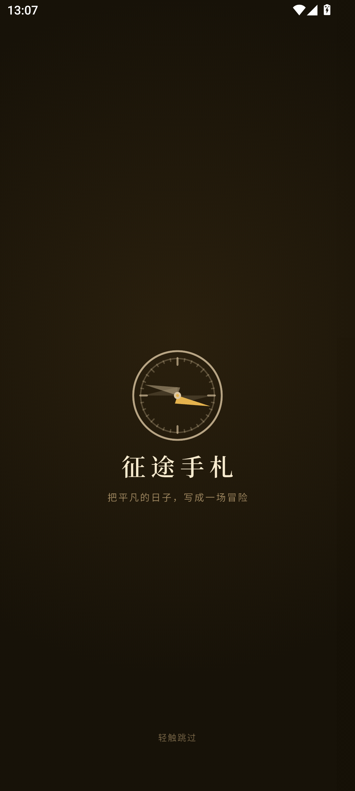
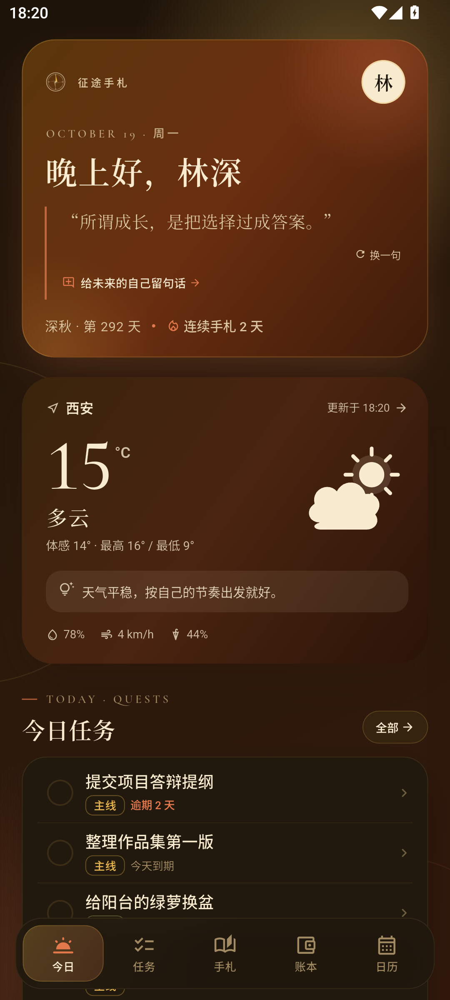
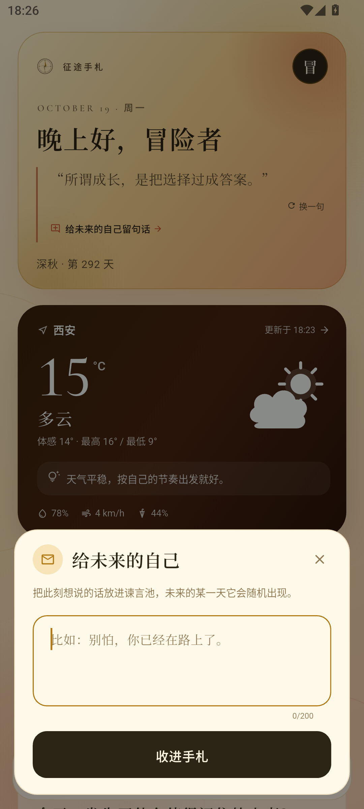

# 征途手札 · Zhengtu Shouzha

> 把平凡的日子，写成一场冒险。

一个**本地优先**的 Android 生活记录 App：手札、任务、账本、天气、日历、谏言、冒险周报、手札精灵与 ZIP 备份。
用 Flutter 写的一份“地球 Online 冒险手札”。

<p align="center">
  
  
  
</p>

## 功能

- **手札**：一天一篇，标题、正文、心情、最多 9 张照片，按月份归档。
- **任务**：主线 / 支线、优先级、截止日期、完成与撤销、分组筛选。
- **账本**：支出 / 收入双类型，10 个支出分类 + 7 个收入分类；金额、备注、月份切换、分类环图、近 7 天节奏、收入与结余。
- **天气**：Open-Meteo 实时天气与 4 日预报，支持定位或手动选城市，带一点天气谏言。
- **日历**：月历上同时看手札、完成任务、支出，点开某天看当日全部记录。
- **谏言**：40 条短句，给日常一点停顿。
- **四季视觉系统**：春（嫩绿+粉）、夏（正绿+蓝）、秋（金黄+橙红）、冬（雪白+灰蓝）；背景光晕、首屏渐变卡、季节天气卡、底栏与设置色卡成套切换。
- **问候与未来留言**：按时段切换早安 / 午安 / 晚安；谏言并入首屏，可给未来的自己留一句话，之后随机出现。
- **冒险周报**：关键词、周叙事、任务 / 支出双柱图、分类环图、本周高光。
- **手札精灵**：4 条完全本地的规则建议，不依赖大模型或网络。
- **分享卡片**：一键生成 1088×1360 的周报 PNG，调起系统分享面板。
- **备份与恢复**：全部记录、设置和照片打包成 ZIP；支持分享、从文件恢复、应用内最近备份恢复。
- **浅色 / 深色**：跟随系统，叠加当季色板；自绘天气图标、罗盘、图表与底部导航。
- **导航与开场**：今日 / 任务 / 手札 / 账本 / 日历，支持左右滑动切换；罗盘开场 0.75 圈后落到左上角。

## 技术栈

| 层 | 选择 |
|---|---|
| 框架 | Flutter 3.47 / Dart 3.13 |
| 状态 | Provider + 单一 `AppStore`（ChangeNotifier） |
| 存储 | sqflite（SQLite）、shared_preferences、应用专属图片目录 |
| 网络 | Open-Meteo（天气，免 Key）、BigDataCloud（逆地理） |
| 定位 / 相册 | geolocator、image_picker |
| 分享 / 备份 | share_plus、archive（ZIP）、file_picker |

## 构建

需要 Flutter 3.47+、JDK 17、Android SDK 36。

```bash
git clone https://github.com/X1Qing-zz/zhengtu-shouzha.git
cd zhengtu-shouzha/app
flutter pub get
flutter build apk --release
```

产物：`app/build/app/outputs/flutter-apk/app-release.apk`。

> **Windows 注意**：Android Gradle Plugin 不支持含非 ASCII 字符的项目路径。
> 请把 `app/` 复制到纯英文路径（例如 `E:\dev\zhengtu_app`）后再构建。

### 演示数据

```bash
flutter run --dart-define=DEMO_MODE=true
```

空数据库时会写入示例手札 / 任务 / 账目，方便看界面；正式包不要带这个参数。

## 下载

Android APK 见 [Releases](https://github.com/X1Qing-zz/zhengtu-shouzha/releases/latest)。
当前为测试包，使用调试签名，**上架前需要替换正式签名**。

## 数据与隐私

- 没有账号、没有服务端，所有记录只存在本机。
- 天气请求只发送城市坐标；定位权限可以拒绝，改用手动选城市。
- 备份 ZIP 默认**不加密**，包含全部手札与照片，请只保存到自己信任的位置。
- 「给未来的自己」的句子只存在本机，并会随备份导出/恢复。
- 卸载 App 会删除本地数据；换机前先在「设置 → 备份与恢复」导出。

## 项目结构

```text
app/
  lib/
    core/       主题、日期、金额、版本
    data/       SQLite、模型、天气、图片、备份、周报
    state/      AppStore
    features/   首页 / 日历 / 手札 / 任务 / 账本 / 天气 / 周报 / 设置
    widgets/    卡片、图表、天气图标、罗盘、底部导航
  test/         31 个单元测试
dist/
  screenshots/  界面截图
```

## 开发状态

- Android：已完成 MVP + 周报 + 备份 + 四季主题 / 导航重排 / 开场动画，在 MuMu Android 15 上验收。
- iOS：工程、图标、权限已配置，但还没有在 macOS 上打包验证。
- 云同步、账号、大模型精灵、通知提醒仍在路线图上。

## 致谢

- 天气：[Open-Meteo](https://open-meteo.com/)
- 逆地理：[BigDataCloud](https://www.bigdatacloud.com/)
- 字体：Noto Serif SC、Cormorant Garamond（SIL Open Font License）

## License

[MIT](LICENSE) © 2026 X1Qing-zz
